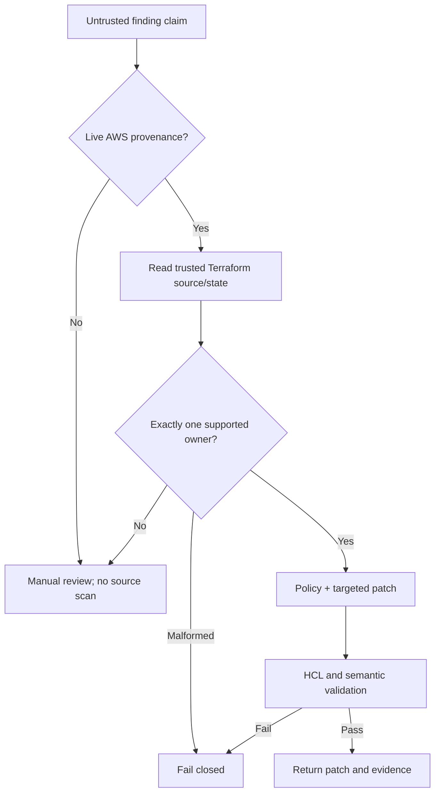
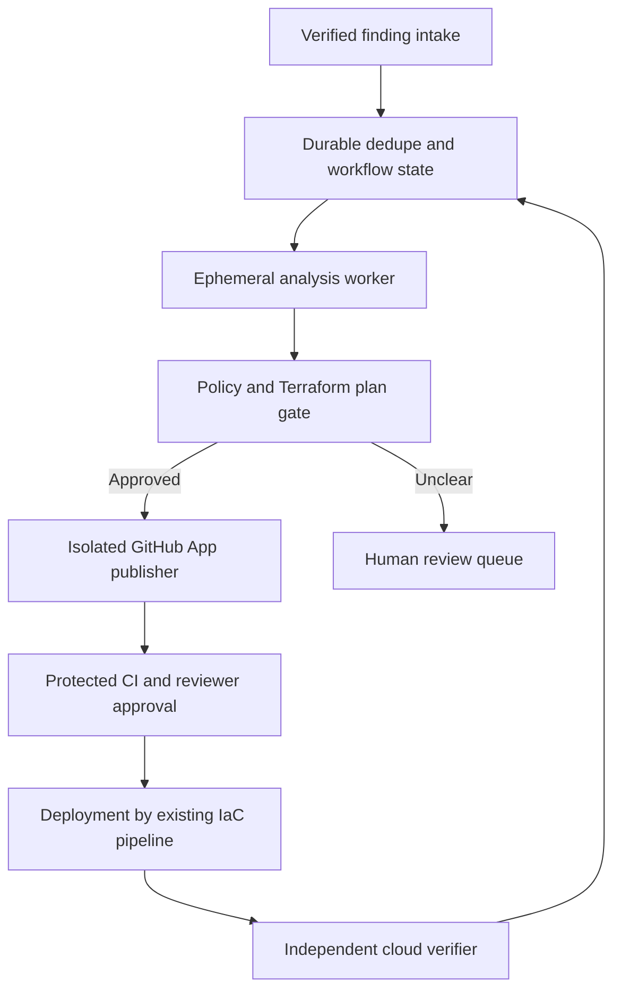

# Architecture

## Architectural position

InfraGuard is a deterministic GitOps remediation planner. The current service stops before all
external writes. A production system should split intake, analysis, publication, and verification
into separately authorized components so that parsing a finding never grants repository or cloud
mutation privileges.

## Current implemented flow



The API process has no GitHub client and does not write the mounted checkout. The lower-level
`write_patch` helper exists for tests and future isolated workers; the API does not call it.
The AWS verification core accepts injected STS/EC2-compatible clients, but no runtime endpoint or
worker currently constructs them. Direct API claims never satisfy the provenance gate.

## Decision boundary

The automation boundary is an explicit conjunction:

```text
fresh Security Hub CSPM event bound to one current EC2 rule
AND exactly one supported Terraform owner
AND operator-approved replacement source
AND targeted patch generated
AND every local validation check passes
= can_open_pr
```

`can_open_pr` is eligibility, not publication. `publication` remains `not_attempted`.

## Current component responsibilities

| Component | Responsibility | Explicitly does not do |
|---|---|---|
| `api/` | Configuration readiness, authentication, untrusted-claim triage, throttling, response sanitization | Attest AWS provenance, clone, write files, call AWS/GitHub, publish PRs |
| `infraguard/aws_verification.py` | Validate one EC2.13 ASFF event and bind it to current read-only AWS rule evidence | Assume roles, configure AWS clients, queue/retry, mutate AWS |
| `infraguard/ownership.py` | Parse HCL/state and prove one supported owner | Evaluate arbitrary Terraform expressions or modules |
| `infraguard/policy.py` | Normalize and constrain replacement CIDRs | Decide whether a network is operationally reachable |
| `infraguard/patches.py` | Produce an in-memory targeted static-HCL change | Apply Terraform or commit to Git |
| `infraguard/validation.py` | Compare before/after semantics and diff shape | Provider-aware validation or plan evaluation |
| `infraguard/evidence.py` | Build machine and reviewer evidence | Sign or persist evidence |

## Ownership proof currently supported

InfraGuard scans root-module `.tf` files and supports these static forms:

- `aws_security_group_rule` using `cidr_blocks` or `ipv6_cidr_blocks`;
- `aws_vpc_security_group_ingress_rule` using `cidr_ipv4` or `cidr_ipv6`;
- literal `security_group_id = "sg-..."`;
- state attributes proving the standalone rule's `security_group_id`;
- a simple `aws_security_group.NAME.id` reference when matching state proves that root resource's
  ID;
- inline ingress classification when state proves the parent `aws_security_group` ID.

Inline rules are deliberately `manual_review`. Modules, nested module addresses, indexed
instances, aliases, dynamic blocks, locals, variables, data sources, and general expression
evaluation are outside the automatic patch boundary.

## Target production architecture



### Required properties

1. **Verified intake:** compose the implemented Security Hub CSPM/EC2 verification core behind an
   encrypted queue, account-owned role policy, durable deduplication, bounded retries, and DLQ.
2. **Durable workflow:** persist a state machine such as `received -> analyzed -> proposed ->
   published -> merged -> deployed -> verified`, plus terminal rejection and failure states.
3. **Immutable analysis:** clone an allowlisted repository into an ephemeral workspace at an exact
   base SHA. Record repository ID, base SHA, file digest, state lineage/serial, policy version, and
   engine version.
4. **Contextual Terraform gate:** run formatting, `terraform init -backend=false`, validation,
   provider lock verification, and an isolated plan. Apply policy to the plan JSON, not only source
   text.
5. **Separated publisher:** mint a short-lived GitHub App installation token only after all gates
   pass. Recheck the base SHA and file digest, create a namespaced branch, and publish one PR.
6. **Protected merge:** require CI, CODEOWNERS/reviewer approval, conversation resolution, and
   branch/ruleset protections. InfraGuard never bypasses these controls.
7. **Independent verification:** after the normal deployment pipeline runs, query AWS and prove the
   public rule is gone. Reopen/escalate if exposure remains.
8. **Tamper-evident evidence:** store hashes and lifecycle transitions in a durable append-only
   audit store with retention and access controls.

## Availability and scaling

The current deployment intentionally uses one replica because rate limiting is in memory and there
is no distributed idempotency. It is incorrect to call the service horizontally scalable today.
Production scale requires a shared limiter, durable queue/state, per-tenant quotas, concurrency
control, worker backpressure, and explicit retry/dead-letter behavior.

## Deployment model

The unsafe model-driven publisher prototype is preserved in Git history, not in the shipping tree.

The Kubernetes manifests are a security-oriented deployment contract for the read-only API, not a
complete platform. They require operator-created secrets, policy configuration, a trusted checkout
PVC, ingress/TLS, and a built/scanned/signed image. See [`../k8s/README.md`](../k8s/README.md) and
[`operations.md`](operations.md).

The exact AWS trust contract and remaining composition requirements are in
[`trusted-finding-provenance.md`](trusted-finding-provenance.md).
