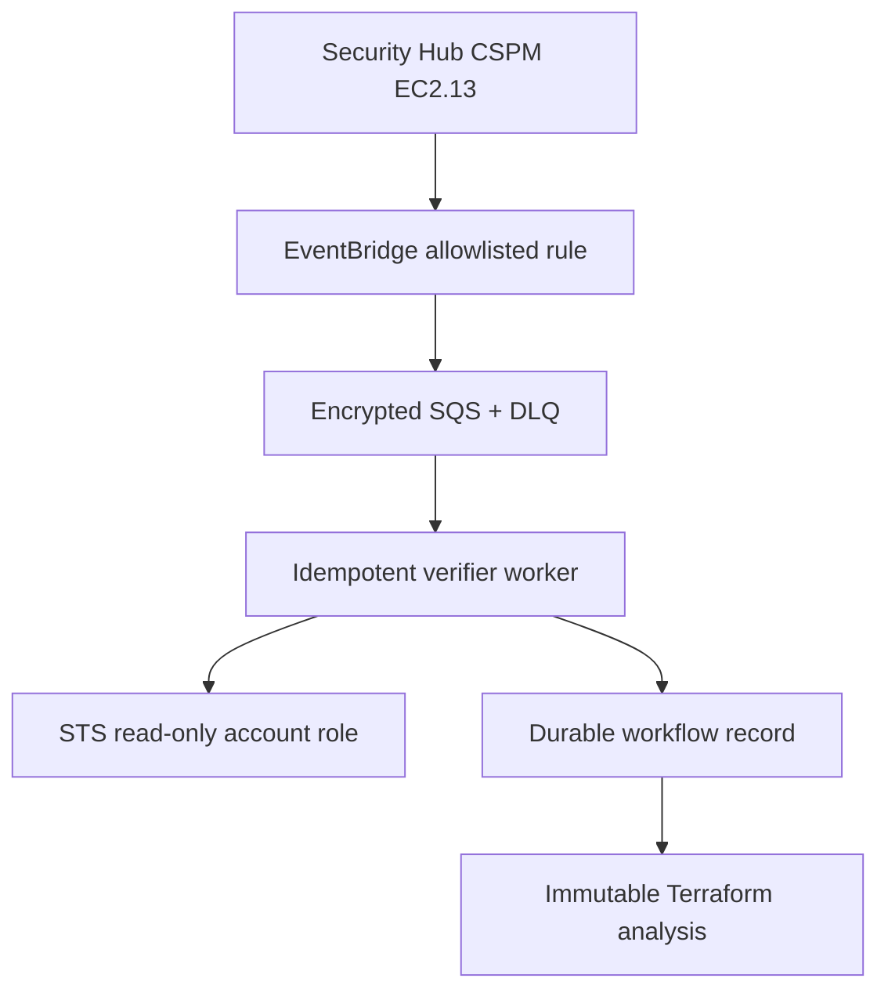

# Trusted AWS finding provenance

## Scope and status

This document defines the first implemented trust boundary for AWS Security Hub CSPM control
`EC2.13`. The pure verification core is implemented in `infraguard/aws_verification.py` and tested
with protocol-compatible fake AWS clients. Runtime AWS credentials, role assumption, EventBridge,
SQS, a worker, durable deduplication, and deployment infrastructure are **not implemented**.

The core converts untrusted event metadata into an automation-eligible `SecurityFinding` only
after an independent, read-only EC2 lookup proves that exactly one current rule in the identified
security group exposes TCP port 22 to `0.0.0.0/0` or `::/0`.

## Why event metadata is insufficient

An authenticated API caller can still submit a false account, resource, rule, or timestamp. An
EventBridge event also describes a past observation rather than current cloud state. Therefore,
neither the API key nor the Security Hub payload authorizes a Terraform change.

AWS Security Hub CSPM control EC2.13 fails when a security group permits unrestricted IPv4 or IPv6
access to TCP port 22: [EC2.13 control](https://docs.aws.amazon.com/securityhub/latest/userguide/ec2-controls.html#ec2-13).
Security Hub CSPM sends ASFF findings through the EventBridge detail type
`Security Hub Findings - Imported`: [CSPM EventBridge formats](https://docs.aws.amazon.com/securityhub/latest/userguide/securityhub-cwe-event-formats.html).

Security Hub V2 also uses the event source `aws.securityhub`, but its detail type and OCSF payload
are different. This verifier intentionally rejects V2 `Findings Imported V2` events instead of
guessing across schemas: [Security Hub V2 event types](https://docs.aws.amazon.com/securityhub/latest/userguide/securityhub-v2-cwe-event-types.html),
[Security Hub V2 event formats](https://docs.aws.amazon.com/securityhub/latest/userguide/securityhub-v2-cwe-event-formats.html).

## Accepted event contract

The parser is deny-by-default and currently accepts one commercial AWS, GovCloud, or China
partition finding with all of these properties:

| Evidence | Required value or relationship |
|---|---|
| EventBridge version | `0` |
| Event source | `aws.securityhub` |
| Detail type | `Security Hub Findings - Imported` |
| Event account | Exact member of deployment-owned `allowed_event_accounts` |
| Event ID | Non-empty, bounded EventBridge-style identifier |
| Event time | Timezone-aware, not stale, and within configured future skew |
| Findings | Exactly one ASFF object |
| ASFF schema | `2018-10-08` |
| Product ARN | Native AWS Security Hub CSPM product in the finding region |
| Control | `Compliance.SecurityControlId == EC2.13` and `Status == FAILED` |
| Lifecycle | `RecordState == ACTIVE`; workflow is `NEW` or `NOTIFIED` |
| Target | Exactly one `AwsEc2SecurityGroup` resource |
| Identity binding | Finding account/region/partition, product ARN, resource ARN, and details agree |
| Observation time | `UpdatedAt` is timezone-aware, fresh, and within future skew |

The finding observation time also cannot postdate the EventBridge envelope by more than the
configured skew.

The current ASFF schema version is documented as `2018-10-08`: [ASFF syntax](https://docs.aws.amazon.com/securityhub/latest/userguide/securityhub-findings-format.html).
The strict single-resource subset is narrower than ASFF itself and deliberately trades coverage for
unambiguous authorization.

Unsupported AWS ISO partitions are rejected by the current ARN grammar. Supporting another
partition requires explicit ARN fixtures, endpoint policy, role policy, and CI coverage.

## Independent live verification

The production composition must first select a role from deployment-owned account policy; no role
ARN may come from the event. It then passes clients using those assumed credentials to the verifier.
The verifier performs these checks:

1. Call STS `GetCallerIdentity`; require the returned account to equal the finding target account.
2. Call EC2 `DescribeSecurityGroupRules` with an exact `group-id` filter in the finding region.
3. Request at most 1,000 rules per page and traverse bounded pagination; reject repeated tokens,
   page-limit overflow, malformed pages, missing AWS request IDs, duplicate rule IDs, and any
   returned owner/group mismatch.
4. Normalize TCP protocol names `tcp` and `6`.
5. Return `resolved` if no current public TCP rule includes port 22.
6. Return `manual_review` for an all-protocol public rule or multiple matching public SSH rules.
7. Return `verified` only for exactly one supported live rule.

The EC2 API exposes the fields used here, including rule ID, group ID, owner, direction, protocol,
ports, and CIDR: [DescribeSecurityGroupRules](https://docs.aws.amazon.com/AWSEC2/latest/APIReference/API_DescribeSecurityGroupRules.html),
[SecurityGroupRule](https://docs.aws.amazon.com/AWSEC2/latest/APIReference/API_SecurityGroupRule.html).

The verified finding contains:

- EventBridge event ID and Security Hub finding ID;
- Security Hub product ARN and source-event account;
- target/verifier account, region, security-group ID, and EC2 rule ID;
- observation and verification timestamps;
- STS and every EC2 page request ID;
- a SHA-256 fingerprint binding account, group, rule ID, direction, protocol, ports, and CIDR.

`SecurityFinding.has_verified_provenance()` recomputes that fingerprint and checks the associated
metadata. Changing the normalized rule, finding ID, account, region, group, or rule identity
without rebuilding provenance invalidates the object and forces `manual_review` before Terraform
files are scanned. This SHA-256 value is a consistency checksum, not a signature or MAC: code that
can construct arbitrary internal Python objects can also recompute it. The production security
boundary must keep untrusted serialization outside this interface and sign or MAC persisted
evidence if it later crosses a trust boundary.

## Outcomes and retry semantics

| Outcome | Meaning | Worker action |
|---|---|---|
| `verified` | Exactly one current supported public SSH rule was independently proven | Continue to repository and Terraform gates |
| `resolved` | Live EC2 state no longer contains a supported public SSH rule | Close as no-op after durable audit recording |
| `manual_review` | Exposure exists, but the automatic patch subset is ambiguous/unsupported | Route to a human; do not patch |
| `rejected` | Event contract, account policy, region, or freshness failed | Record terminal rejection; do not retry unchanged input |
| `AwsVerificationError` | STS/EC2 call failed or AWS returned malformed/incomplete evidence | Retry with bounded backoff; dead-letter after limit |

The runtime worker must preserve this distinction. Treating a rejected event as retryable creates a
poison-message loop; treating an AWS outage as terminal silently loses findings.

## Required production composition

Before this path can be called production-ready:

- EventBridge-to-SQS access must use a narrowly scoped SQS resource policy. AWS documents that SQS
  targets use resource-based policies: [EventBridge target permissions](https://docs.aws.amazon.com/eventbridge/latest/userguide/eb-use-resource-based.html).
- Configure a dead-letter queue and alarms for failed target delivery: [EventBridge DLQs](https://docs.aws.amazon.com/eventbridge/latest/userguide/eb-rule-dlq.html).
- Use SSE-KMS with a key policy covering EventBridge, SQS, and the worker; restrict queue and key
  administration separately from message consumption.
- Expect duplicate delivery. Standard SQS provides at-least-once delivery, so the durable workflow
  key must make processing idempotent: [SQS at-least-once delivery](https://docs.aws.amazon.com/AWSSimpleQueueService/latest/SQSDeveloperGuide/standard-queues-at-least-once-delivery.html).
- Map target account IDs to preconfigured role ARNs. For third-party cross-account deployments,
  require a per-customer external ID to mitigate confused-deputy risk: [IAM external IDs](https://docs.aws.amazon.com/IAM/latest/UserGuide/id_roles_common-scenarios_third-party.html).
- Limit the role to `ec2:DescribeSecurityGroupRules` and required identity calls, constrain trust to
  the verifier workload, use short sessions, and audit CloudTrail. STS documents session behavior
  and role assumption constraints: [AssumeRole](https://docs.aws.amazon.com/STS/latest/APIReference/API_AssumeRole.html).
- Persist a conditional idempotency record before analysis. A candidate key is tenant + finding ID +
  rule fingerprint + repository + base SHA + policy version; the final schema requires an ADR and
  load/concurrency tests.
- Bound message size, event age, queue retention, receive count, visibility timeout, page count,
  AWS API timeouts, and worker CPU/memory/runtime.

## Explicit non-claims

This implementation does not yet prove:

- EventBridge/SQS deployment or IAM/KMS correctness;
- live operation against an AWS test account;
- durable deduplication, replay handling, or workflow state;
- repository selection, checkout authenticity, or Terraform state provenance;
- `terraform validate`, plan safety, GitHub publication, deployment, or post-deployment closure.

Those remain release blockers in `production-readiness.md`.
